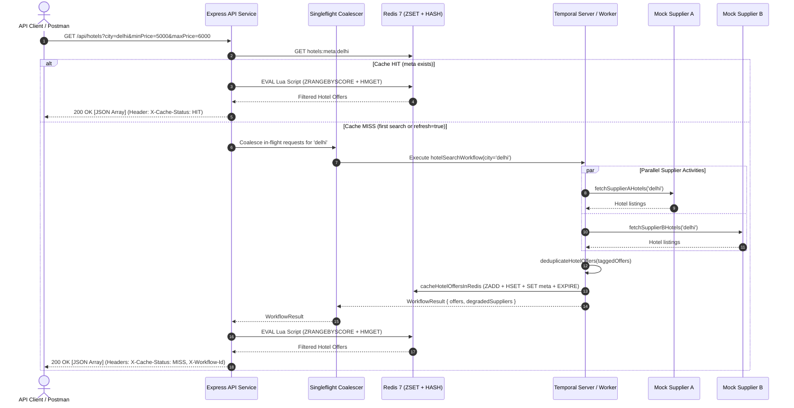

# Hotel Offer Orchestrator

[](https://www.typescriptlang.org/)
[](https://nodejs.org/)
[](https://temporal.io/)
[](https://redis.io/)
[](https://www.docker.com/)
[]()
[](http://localhost:3000/docs)
[](http://localhost:3000/metrics)

A production-grade, distributed hotel offer aggregation and pricing engine. Orchestrated using **Temporal.io** for deterministic workflow execution and fault tolerance, powered by **Redis 7 native range indexing (`ZSET` + `HASH` + atomic Lua scripts)** for high-throughput price filtering, containerized with multi-stage **Docker**, and verified end-to-end.

---

## Standout Architectural Decisions

1. **Native Redis-Side Range Indexing & Lua Scripting (Zero In-Memory Filtering)**
   - Instead of fetching bloated JSON blobs and filtering inside Node.js heap memory, offers are indexed using a native Redis **Sorted Set (`ZSET`)** `hotels:prices:{city}` (score = price) and stored in a **Hash (`HASH`)** `hotels:data:{city}`.
   - Price range queries (`minPrice` to `maxPrice`) execute directly inside the Redis engine in a **single atomic Lua script (`EVAL`)** roundtrip via `ZRANGEBYSCORE` + `HMGET`.
   - Optional Redis-side pagination (`limit` & `offset`) is supported directly in the Lua script (`LIMIT offset count`).
   - Empty search results (e.g. unknown cities) are explicitly tracked in `hotels:meta:{city}` with TTL to eliminate cache-miss stampedes.

2. **Singleflight Request Coalescing (Thundering Herd / Cache Stampede Defense)**
   - When a popular city's TTL expires, concurrent requests are merged into a single in-flight promise (`SingleflightGroup`). Only one Temporal workflow is executed, preventing duplicate work and upstream load spikes.

3. **Temporal.io Workflow Determinism & Graceful Partial Failures**
   - Workflow logic (`src/temporal/workflows.ts`) is strictly deterministic with zero non-deterministic side effects (`Date.now()`, `Math.random()`, or direct I/O).
   - Upstream supplier activities (`fetchSupplierAHotels` and `fetchSupplierBHotels`) run in **parallel** via `Promise.allSettled()`.
   - **Graceful Fallback:** If one supplier suffers an outage or exhausts its retry budget, the workflow logs a warning, flags `degradedSuppliers`, and continues fulfilling client requests with the healthy supplier.
   - If both suppliers fail, the workflow throws an `ApplicationFailure`, returning `503 Service Unavailable`.
   - Caching in Redis is executed as a durable Temporal Activity (`cacheHotelOffersInRedis`), making cache population transparent and visible in the Temporal Web UI.
   - **Real-time Workflow Queries & Signals:** Exposes `getExecutionStatus` query and `cancelWorkflow` signal for real-time workflow inspection.

4. **Multi-Tier Deduplication & Best-Offer Selection**
   - Hotels are canonicalized using whitespace collapse, punctuation removal, and case-insensitive matching (`normalizeHotelName`).
   - Tie-breaking hierarchy:
     1. **Lowest Price** wins.
     2. If prices are identical: **Highest `commissionPct`** wins (maximizing platform margin).
     3. If commission is also identical: Deterministic alphabetical ordering by supplier name.

5. **Production Observability & Documentation**
   - **Interactive Swagger UI:** Available at `/docs` (and `/docs.json`) for 1-click browser testing of all endpoints.
   - **Prometheus Metrics:** Standard `/metrics` endpoint exposing HTTP request counts, latency histograms, cache hit/miss counters, and Temporal workflow durations.
   - **Correlation IDs:** Standard `X-Request-Id` propagated across all logs and response headers.

6. **Defensive Edge Protection**
   - Security headers with `helmet` (`nosniff`, `HSTS`, `X-Frame-Options`).
   - Rate limiting with `express-rate-limit` on `/api` routes (500 req/min with standard `RateLimit-*` headers).

---

## System Architecture



---

## Project Structure

```text
.
├── .github/
│   └── workflows/
│       └── ci.yml                  # GitHub Actions CI pipeline
├── src/
│   ├── api/
│   │   ├── app.ts                  # Express app factory (helmet, rate limiter, routes)
│   │   ├── docs/
│   │   │   └── swagger.ts          # OpenAPI 3.0 specification
│   │   ├── routes/
│   │   │   ├── hotels.routes.ts    # GET /api/hotels (singleflight & Redis Lua filtering)
│   │   │   ├── suppliers.routes.ts # Mock suppliers (/supplierA/hotels, /supplierB/hotels)
│   │   │   ├── admin.routes.ts     # Chaos / Fault-injection controls
│   │   │   ├── health.routes.ts    # Deep health probe (/health)
│   │   │   └── metrics.routes.ts   # Prometheus metrics (/metrics)
│   │   └── middleware/
│   │       ├── requestId.ts        # Correlation ID (X-Request-Id)
│   │       └── errorHandler.ts     # Centralized error handler
│   ├── config/
│   │   └── env.ts                  # Zod-validated environment config
│   ├── domain/
│   │   ├── types.ts                # TypeScript domain models
│   │   └── deduplicate.ts          # Pure deduplication & tie-breaking engine
│   ├── services/
│   │   ├── redis.service.ts        # Redis ZSET + HASH + Lua script engine
│   │   └── temporal.service.ts     # Temporal client & workflow runner
│   ├── suppliers/
│   │   ├── mockData.ts             # Deterministic mock datasets (Delhi & Mumbai)
│   │   └── supplierState.ts        # In-memory chaos state manager
│   ├── temporal/
│   │   ├── workflows.ts            # Deterministic Temporal workflow (Queries & Signals)
│   │   ├── activities.ts           # Supplier HTTP fetching & Redis caching activities
│   │   └── constants.ts            # Task queues and retry policies
│   ├── utils/
│   │   ├── logger.ts               # Pino structured JSON logger
│   │   ├── metrics.ts              # Prometheus metrics registry
│   │   └── singleflight.ts         # In-flight request coalescer
│   ├── server.ts                   # HTTP API entrypoint
│   └── worker.ts                   # Temporal Worker entrypoint
├── tests/
│   ├── unit/
│   │   └── deduplicate.test.ts     # Pure deduplication, tie-breaker & normalization tests
│   └── integration/
│       ├── redis.service.test.ts   # Redis ZSET indexing, pagination, & Lua filtering tests
│       └── api.test.ts             # API routes, metrics, docs, fault injection, & validation
├── postman/
│   └── Hotel_Offer_Orchestrator.postman_collection.json # Complete Postman v2.1 collection
├── Dockerfile                      # Multi-stage production build (node:22-bookworm-slim)
├── docker-compose.yml              # 1-command stack (redis, temporal, api, worker)
├── package.json
├── tsconfig.json
└── README.md
```

---

## Quick Start (Docker Compose)

The entire distributed stack (Redis 7, Temporal Server with Web UI, HTTP API, and Temporal Worker) starts with a single command:

```bash
docker compose up --build -d
```

### Service Map

| Service | Port | Description |
|---|---|---|
| **HTTP API** | `http://localhost:3000` | Hotel search, mock suppliers, admin, and health check |
| **Interactive Docs** | `http://localhost:3000/docs` | Swagger UI OpenAPI documentation |
| **Prometheus Metrics**| `http://localhost:3000/metrics` | Prometheus metrics scrape target |
| **Temporal Web UI** | `http://localhost:8080` | Live workflow monitoring, replay debugging, activity timeline |
| **Temporal gRPC** | `localhost:7233` | Temporal cluster gRPC endpoint |
| **Redis** | `localhost:6379` | Native Redis 7 server |

---

## API Reference & `curl` Examples

### 1. Search Hotels with Deduplication
```bash
curl -i "http://localhost:3000/api/hotels?city=delhi"
```
**Response (`200 OK`):**
```json
[
  {
    "name": "Holtin",
    "price": 5340,
    "supplier": "Supplier B",
    "commissionPct": 20
  },
  {
    "name": "Radison",
    "price": 5900,
    "supplier": "Supplier A",
    "commissionPct": 13
  },
  {
    "name": "Leela Ambience",
    "price": 7200,
    "supplier": "Supplier A",
    "commissionPct": 14
  },
  {
    "name": "Taj Palace",
    "price": 8500,
    "supplier": "Supplier B",
    "commissionPct": 18
  },
  {
    "name": "ITC Maurya",
    "price": 9100,
    "supplier": "Supplier B",
    "commissionPct": 17
  },
  {
    "name": "the oberoi",
    "price": 11500,
    "supplier": "Supplier B",
    "commissionPct": 16
  }
]
```

---

### 2. Redis-Side Price Range Filtering & Pagination
```bash
# Filter between 5000 and 6000
curl -i "http://localhost:3000/api/hotels?city=delhi&minPrice=5000&maxPrice=6000"

# Optional pagination (top 2 results via Redis LIMIT)
curl -i "http://localhost:3000/api/hotels?city=delhi&limit=2&offset=0"
```

---

### 3. Deep System Health Check
```bash
curl -i "http://localhost:3000/health"
```
**Response (`200 OK`):**
```json
{
  "status": "healthy",
  "timestamp": "2026-11-21T12:00:00.000Z",
  "uptimeSeconds": 142,
  "dependencies": {
    "redis": { "status": "up", "latencyMs": 1 },
    "temporal": { "status": "up", "latencyMs": 3 },
    "supplierA": { "status": "up", "latencyMs": 0 },
    "supplierB": { "status": "up", "latencyMs": 0 }
  }
}
```

---

### 4. Chaos / Fault Injection Demonstration
Simulate an outage in Supplier A:
```bash
curl -i -X POST "http://localhost:3000/admin/suppliers/supplierA/status" \
  -H "Content-Type: application/json" \
  -d '{"healthy": false}'
```

Verify degraded health status:
```bash
curl -i "http://localhost:3000/health"
```
*(Returns `status: "degraded"` with `supplierA: "down"` and `supplierB: "up"`)*

Query hotels with `refresh=true` to force a new workflow execution:
```bash
curl -i "http://localhost:3000/api/hotels?city=delhi&refresh=true"
```
*(Returns `200 OK` with Supplier B hotels and header `X-Degraded-Suppliers: Supplier A`)*

Restore Supplier A:
```bash
curl -i -X POST "http://localhost:3000/admin/suppliers/supplierA/status" \
  -H "Content-Type: application/json" \
  -d '{"healthy": true}'
```

---

### 5. Prometheus Metrics
```bash
curl -s "http://localhost:3000/metrics"
```
Returns standard Prometheus text metrics: `hotel_http_requests_total`, `hotel_cache_hits_total`, `hotel_cache_misses_total`, heap space gauges, and garbage collection histograms.

---

### 6. Interactive OpenAPI / Swagger UI
Navigate to `http://localhost:3000/docs` in your web browser.

---

## License
MIT
