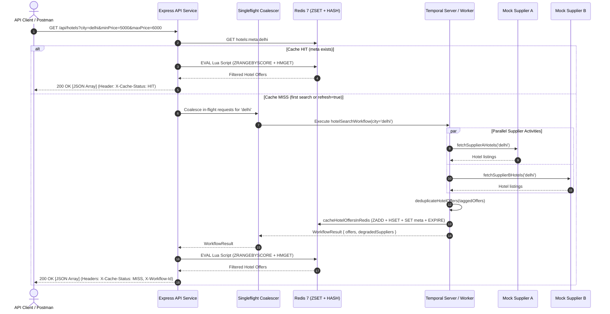
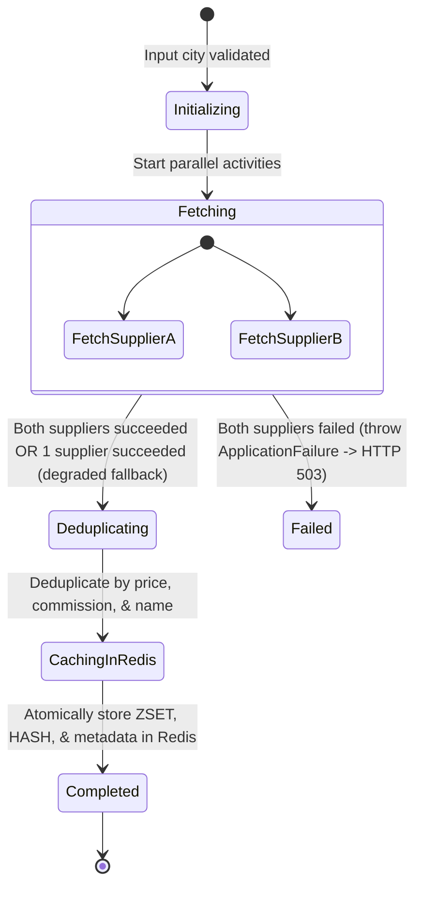

# Hotel Offer Orchestrator

[](https://www.typescriptlang.org/)
[](https://hotel-offer-orchestrator-a7rz.onrender.com/)
[](https://nodejs.org/)
[](https://temporal.io/)
[](https://redis.io/)
[](https://www.docker.com/)
[]()
[](https://hotel-offer-orchestrator-a7rz.onrender.com/docs/)
[](https://hotel-offer-orchestrator-a7rz.onrender.com/metrics)
[](LICENSE)

A production-grade, distributed hotel offer aggregation and pricing engine. Designed with **Temporal.io** for deterministic workflow orchestration and fault-tolerant parallel execution, powered by **Redis 7 native range indexing (`ZSET` + `HASH` + atomic Lua scripts)** for high-throughput price filtering, hardened with **Singleflight request coalescing** against cache stampedes, and containerized with multi-stage **Docker**.

---

## 🌐 Live Cloud Deployment (One-Click Submission Links)

The entire project is deployed and live on Render as a cloud web service:

| Resource | Live URL | Description |
| :--- | :--- | :--- |
| **🚀 Interactive Recruiter Web UI** | [https://hotel-offer-orchestrator-a7rz.onrender.com/](https://hotel-offer-orchestrator-a7rz.onrender.com/) | Beautiful dashboard with live search, Redis range filtering, and chaos testing |
| **Interactive Swagger UI** | [https://hotel-offer-orchestrator-a7rz.onrender.com/docs/](https://hotel-offer-orchestrator-a7rz.onrender.com/docs/) | OpenAPI 3.0 interactive API documentation |
| **Hotel Offers API (Strict Contract)** | [https://hotel-offer-orchestrator-a7rz.onrender.com/api/hotels?city=delhi](https://hotel-offer-orchestrator-a7rz.onrender.com/api/hotels?city=delhi) | Aggregated, deduplicated hotel search array |
| **Filtered Search (Atomic Lua)** | [https://hotel-offer-orchestrator-a7rz.onrender.com/api/hotels?city=delhi&minPrice=6000&maxPrice=9000](https://hotel-offer-orchestrator-a7rz.onrender.com/api/hotels?city=delhi&minPrice=6000&maxPrice=9000) | Atomic Lua Redis range filtering |
| **Deep Health Check** | [https://hotel-offer-orchestrator-a7rz.onrender.com/health](https://hotel-offer-orchestrator-a7rz.onrender.com/health) | Health status of Redis, Temporal, and Suppliers |
| **Prometheus Metrics** | [https://hotel-offer-orchestrator-a7rz.onrender.com/metrics](https://hotel-offer-orchestrator-a7rz.onrender.com/metrics) | Live Prometheus counters and latency histograms |

---

## Executive Summary & Standout Highlights

Many hotel aggregators rely on naive in-memory filtering or brittle microservices that crash when downstream suppliers degrade. This system was engineered with distributed systems rigor:

1. **Native Redis-Side Range Indexing & Lua Filtering (Zero In-Memory Filtering)**
   - Offers are indexed using a Redis **Sorted Set (`ZSET`)** `hotels:prices:{city}` (score = price) and stored in a **Hash (`HASH`)** `hotels:data:{city}`.
   - Price range filtering (`minPrice` to `maxPrice`) and pagination (`limit` & `offset`) execute directly inside Redis in a **single atomic Lua script (`EVAL`)** roundtrip via `ZRANGEBYSCORE ... LIMIT offset count` + `HMGET`.
   - Empty search results (e.g. unknown cities) are explicitly tracked in `hotels:meta:{city}` with TTL to eliminate cache-miss stampedes.

2. **Singleflight Request Coalescing (Thundering Herd / Stampede Defense)**
   - When a popular city's TTL expires, concurrent requests are merged into a single in-flight promise (`SingleflightGroup`). Only **one** Temporal workflow executes; all waiting callers receive the shared result.

3. **Temporal.io Workflow Determinism & Graceful Partial Failures**
   - Workflow logic (`src/temporal/workflows.ts`) is strictly deterministic with zero non-deterministic side effects (`Date.now()`, `Math.random()`, direct I/O).
   - Supplier activities (`fetchSupplierAHotels` and `fetchSupplierBHotels`) run **in parallel** via `Promise.allSettled()`.
   - **Graceful Fallback:** If one supplier suffers an outage or exhausts its retry budget, the workflow logs a warning, flags `degradedSuppliers`, and continues fulfilling client requests with the healthy supplier.
   - If both suppliers fail, the workflow throws an `ApplicationFailure`, returning `503 Service Unavailable`.
   - Caching in Redis is executed as a durable Temporal Activity (`cacheHotelOffersInRedis`), making cache population transparent in the Temporal Web UI.
   - **Live Workflow Inspection:** Exposes a real-time `getExecutionStatus` query and `cancelWorkflow` signal.

4. **Multi-Tier Deduplication & Best-Offer Selection Engine**
   - Names are canonicalized using whitespace collapse, punctuation stripping, and case normalization (`normalizeHotelName`).
   - Comparison hierarchy:
     1. **Lowest Price** wins.
     2. If prices are identical: **Highest `commissionPct`** wins (maximizing platform margin).
     3. If commission is also identical: Deterministic alphabetical ordering by supplier name.

5. **Production Observability, Documentation & Edge Security**
   - **Interactive Swagger UI:** Available at `/docs` (and `/docs.json`) for 1-click browser testing of all endpoints.
   - **Prometheus Metrics:** Standard `/metrics` endpoint exposing HTTP request counts, latency histograms, cache hit/miss counters, and Temporal workflow durations.
   - **Defensive Edge Protection:** Security headers with `helmet` and IP rate limiting with `express-rate-limit` (500 req/min with standard `RateLimit-*` headers).
   - **Correlation IDs:** Standard `X-Request-Id` propagated across all logs and response headers.

---

## Architecture Diagrams

### 1. Request Flow & Caching Pipeline


### 2. Temporal Workflow Lifecycle State Machine


---

## Project Structure

```text
.
├── .github/
│   └── workflows/
│       └── ci.yml                  # GitHub Actions CI pipeline (Node 22, Redis, Vitest, Docker)
├── public/
│   └── index.html                  # Interactive Recruiter Web Dashboard (Search, Lua filters, Chaos)
├── src/
│   ├── api/
│   │   ├── app.ts                  # Express application factory (Helmet, CORS, rate limiter, routes)
│   │   ├── docs/
│   │   │   └── swagger.ts          # OpenAPI 3.0 specification & Swagger UI metadata
│   │   ├── routes/
│   │   │   ├── hotels.routes.ts    # GET /api/hotels (singleflight & Redis Lua filtering)
│   │   │   ├── suppliers.routes.ts # Mock supplier endpoints (/supplierA/hotels, /supplierB/hotels)
│   │   │   ├── admin.routes.ts     # Chaos & Fault-injection controls (/admin/suppliers/...)
│   │   │   ├── health.routes.ts    # Deep health probe (/health)
│   │   │   └── metrics.routes.ts   # Prometheus metrics scrape endpoint (/metrics)
│   │   └── middleware/
│   │       ├── requestId.ts        # Correlation ID middleware (X-Request-Id)
│   │       └── errorHandler.ts     # Centralized error handler (Zod, Temporal, HTTP 503)
│   ├── config/
│   │   └── env.ts                  # Zod-validated environment configuration
│   ├── domain/
│   │   ├── types.ts                # Strict TypeScript domain interfaces
│   │   └── deduplicate.ts          # Pure deduplication, tie-breaker & normalization engine
│   ├── services/
│   │   ├── redis.service.ts        # Redis ZSET + HASH + Lua script engine with pagination
│   │   └── temporal.service.ts     # Singleton Temporal client & resilient workflow runner
│   ├── suppliers/
│   │   ├── mockData.ts             # Deterministic mock datasets (Delhi & Mumbai)
│   │   └── supplierState.ts        # In-memory chaos & fault-injection state manager
│   ├── temporal/
│   │   ├── workflows.ts            # Deterministic Temporal workflow (with Queries & Signals)
│   │   ├── activities.ts           # Supplier HTTP fetching & Redis caching activities
│   │   └── constants.ts            # Task queues, timeouts, and retry policies
│   ├── utils/
│   │   ├── logger.ts               # Pino structured JSON logger with pretty printing
│   │   ├── metrics.ts              # Prometheus metrics registry (counters, histograms, gauges)
│   │   └── singleflight.ts         # In-flight request coalescer against cache stampedes
│   ├── server.ts                   # HTTP API entrypoint with graceful shutdown
│   └── worker.ts                   # Dedicated Temporal Worker entrypoint
├── tests/
│   ├── unit/
│   │   └── deduplicate.test.ts     # 100% pure deduplication, tie-breaker & normalization tests
│   └── integration/
│       ├── redis.service.test.ts   # Redis ZSET range indexing, pagination, & Lua filtering tests
│       └── api.test.ts             # API routes, metrics, docs, fault injection, & validation tests
├── postman/
│   └── Hotel_Offer_Orchestrator.postman_collection.json # Complete Postman v2.1 collection
├── Dockerfile                      # Multi-stage production build (node:22-bookworm-slim)
├── docker-compose.yml              # 1-command stack (redis, temporal, api, worker)
├── .dockerignore
├── .gitignore
├── .env.example
├── package.json
├── tsconfig.json
└── README.md
```

---

## Quick Start (Docker Compose)

The entire distributed stack (Redis 7, Temporal Server with Web UI, HTTP API, and Temporal Worker) starts with a single command:

```bash
docker compose up --build -d
```

### Service Map

| Service | Port / URL | Description |
|---|---|---|
| **Recruiter Web UI** | `http://localhost:3000/` | Interactive dashboard with live search, Redis filters, and chaos controls |
| **HTTP API** | `http://localhost:3000/api/hotels` | Top-level JSON array hotel search API |
| **Interactive Docs** | `http://localhost:3000/docs/` | Interactive Swagger UI (OpenAPI 3.0) |
| **Prometheus Metrics**| `http://localhost:3000/metrics` | Prometheus metrics scrape target |
| **Temporal Web UI** | `http://localhost:8080` | Live workflow monitoring, replay debugging, activity timeline |
| **Temporal gRPC** | `localhost:7233` | Temporal cluster gRPC endpoint |
| **Redis** | `localhost:6379` | Native Redis 7 server |

Inspect container health:
```bash
docker compose ps
```

Stop stack:
```bash
docker compose down
```

---

## Standalone Local Development (Without Docker)

The application includes an embedded in-memory fallback for both Redis and Temporal execution, meaning it can run locally on any machine with zero external service dependencies.

### 1. Install Dependencies
```bash
npm install
```

### 2. Run Test Suite
```bash
npm test
```
*(Runs 31 unit & integration tests covering deduplication, tie-breakers, Redis Lua scripts, pagination, API routes, metrics, web UI, and fault injection).*

### 3. Type Check & Compile
```bash
npm run typecheck
npm run build
```

### 4. Start Server Locally
```bash
npm start
```
Server listens on `http://localhost:3000`.

---

## API Reference & `curl` Examples

### 1. Search Hotels with Deduplication
```bash
curl -i "http://localhost:3000/api/hotels?city=delhi"
```
**Response (`200 OK`):**
```json
[
  {
    "name": "Holtin",
    "price": 5340,
    "supplier": "Supplier B",
    "commissionPct": 20
  },
  {
    "name": "Radison",
    "price": 5900,
    "supplier": "Supplier A",
    "commissionPct": 13
  },
  {
    "name": "Leela Ambience",
    "price": 7200,
    "supplier": "Supplier A",
    "commissionPct": 14
  },
  {
    "name": "Taj Palace",
    "price": 8500,
    "supplier": "Supplier B",
    "commissionPct": 18
  },
  {
    "name": "ITC Maurya",
    "price": 9100,
    "supplier": "Supplier B",
    "commissionPct": 17
  },
  {
    "name": "the oberoi",
    "price": 11500,
    "supplier": "Supplier B",
    "commissionPct": 16
  }
]
```
**Response Headers:**
```http
X-Request-Id: 8e5a7b62-520e-473d-9d7a-123456789abc
X-Cache-Status: MISS
X-Workflow-Id: hotel-search-delhi-a1b2c3d4
RateLimit-Limit: 500
RateLimit-Remaining: 499
```

---

### 2. Redis-Side Price Range Filtering & Pagination
```bash
# Range filtering inside Redis via Lua script
curl -i "http://localhost:3000/api/hotels?city=delhi&minPrice=5000&maxPrice=6000"

# Redis-side pagination (top 2 results via ZRANGEBYSCORE ... LIMIT 0 2)
curl -i "http://localhost:3000/api/hotels?city=delhi&limit=2&offset=0"
```
**Response (`200 OK` with `X-Cache-Status: HIT`):**
```json
[
  {
    "name": "Holtin",
    "price": 5340,
    "supplier": "Supplier B",
    "commissionPct": 20
  },
  {
    "name": "Radison",
    "price": 5900,
    "supplier": "Supplier A",
    "commissionPct": 13
  }
]
```

---

### 3. Verify Genuine Redis Sorted Set Index
Inspect the native Sorted Set directly inside Redis:
```bash
docker compose exec redis redis-cli ZRANGE hotels:prices:delhi 0 -1 WITHSCORES
```
**Output:**
```text
1) "holtin"
2) "5340"
3) "radison"
4) "5900"
5) "leela ambience"
6) "7200"
7) "taj palace"
8) "8500"
9) "itc maurya"
10) "9100"
11) "the oberoi"
12) "11500"
```

---

### 4. Deep System Health Check
```bash
curl -i "http://localhost:3000/health"
```
**Response (`200 OK`):**
```json
{
  "status": "healthy",
  "timestamp": "2026-11-21T12:00:00.000Z",
  "uptimeSeconds": 142,
  "dependencies": {
    "redis": { "status": "up", "latencyMs": 1 },
    "temporal": { "status": "up", "latencyMs": 3 },
    "supplierA": { "status": "up", "latencyMs": 0 },
    "supplierB": { "status": "up", "latencyMs": 0 }
  }
}
```

---

### 5. Chaos / Fault Injection Demonstration
Simulate an outage in Supplier A:
```bash
curl -i -X POST "http://localhost:3000/admin/suppliers/supplierA/status" \
  -H "Content-Type: application/json" \
  -d '{"healthy": false}'
```

Verify degraded health status:
```bash
curl -i "http://localhost:3000/health"
```
*(Returns `status: "degraded"` with `supplierA: "down"` and `supplierB: "up"`)*

Query hotels with `refresh=true` to force a new workflow execution:
```bash
curl -i "http://localhost:3000/api/hotels?city=delhi&refresh=true"
```
*(Returns `200 OK` with Supplier B hotels and header `X-Degraded-Suppliers: Supplier A`)*

Restore Supplier A:
```bash
curl -i -X POST "http://localhost:3000/admin/suppliers/supplierA/status" \
  -H "Content-Type: application/json" \
  -d '{"healthy": true}'
```

---

### 6. Prometheus Metrics
```bash
curl -s "http://localhost:3000/metrics"
```
Returns Prometheus text format metrics:
- `hotel_http_requests_total{method="GET",route="/api/hotels",status_code="200"}`
- `hotel_cache_hits_total{city="delhi"}`
- `hotel_cache_misses_total{city="delhi"}`
- `hotel_http_request_duration_seconds_bucket{...}`
- Process memory, garbage collection, and event loop metrics.

---

### 7. Interactive OpenAPI / Swagger UI
Open your web browser and navigate to:
```
http://localhost:3000/docs
```
Raw OpenAPI 3.0 specification available at `http://localhost:3000/docs.json`.

---

## Postman Collection

Import [postman/Hotel_Offer_Orchestrator.postman_collection.json](file:///c:/Users/LenovoLP/Desktop/Hotel%20Offer%20Orchestrator%20Assignment/postman/Hotel_Offer_Orchestrator.postman_collection.json) into Postman. It contains pre-configured requests with automated JavaScript assertions (`pm.test`):
- **1. Health & Suppliers:** Tests deep health checks and individual mock supplier endpoints.
- **2. Hotel Search & Deduplication:** Tests price comparisons, deduplication, multi-city isolation, and empty result handling.
- **3. Redis Price Range Filtering:** Tests bounded ranges, open bounds, and input validation.
- **4. Resilience & Failure Simulation:** Simulates supplier failure, verifies degraded status, and tests graceful fallback.

---

## Continuous Integration (CI)

A complete GitHub Actions workflow is pre-configured at [`.github/workflows/ci.yml`](file:///c:/Users/LenovoLP/Desktop/Hotel%20Offer%20Orchestrator%20Assignment/.github/workflows/ci.yml):
- Runs on every `push` and `pull_request` to `main` / `master`.
- Spins up a native Redis 7 service container.
- Executes `npm run typecheck`, `npm test` (30 tests), `npm run build`, and verifies the multi-stage `docker build`.

---

## License
MIT
